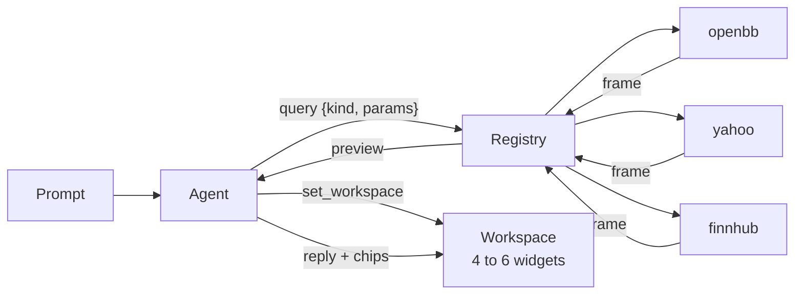

<div align="center">

# Open Terminal

**The open-source, AI-native terminal for traders.**

Ask a question. Get a live workspace of charts, tables and option chains, and an answer that points at them.<br/>
Runs on your machine, with your keys, on data sources anyone can add.

[](LICENSE)
[](package.json)
[](#quick-start)
[](#data)

[Quick start](#quick-start) · [Why](#why) · [How it works](#how-it-works) · [Data](#data) · [Extend](#extend) · [Compare](#how-it-compares) · [Roadmap](#roadmap) · [Contributing](#contributing)

</div>

<br/>


<br/>

Cursor made the code editor conversational without taking the editor away. Open Terminal does the same for the trading terminal. The prompt builds and rewrites the workspace, and the workspace stays a real terminal: every widget is a query you can open, edit and re-run by hand.

## Why

- **Ask, don't click.** "Is NVDA's drop today news or just the market?" becomes four live widgets and a two-sentence diagnosis. A follow-up rewrites the workspace. You never assemble the answer from eight tabs again.
- **Every number is traceable.** The agent cannot type a price. It can only run queries, and the reply links each claim to the widget that shows it. No hallucinated figures, no stale screenshots.
- **Open and local.** MIT licensed. One process on localhost plus your browser. No accounts, no hosted backend, no telemetry. Keys never leave the machine.
- **Extensible by contract.** A query is `{ kind, params }` and a result is a typed frame. 22 kinds cover prices, fundamentals, estimates, ownership, options, macro and more. A connector that answers one of them is about 50 lines, tested against recorded fixtures.
- **Model-agnostic.** Anthropic or OpenAI through the Vercel AI SDK. The default is Claude Opus 5.5; change one line of config to swap it.
- **Works before you add a key.** Prices, charts, search and earnings come from Yahoo on first run. Add a free Finnhub key for news, or point it at a local OpenBB Platform for dozens of providers.

## How it works



1. You type a prompt. The agent has two tools: `query` runs one query from the catalog, `set_workspace` replaces the widgets.
2. Each query goes to the registry, which asks the first connector that answers that kind and falls through on error. Results are frames: typed columns plus rows, cached per kind.
3. The agent sees a preview of every frame it ran: the columns, the first rows, and per-symbol stats. Numbers in the reply must come from here.
4. It emits a workspace, four to six widgets by default or the one or two you asked for, each a query rendered by a view: `series` for charts, `table` for anything, `chain` for options. Then a short reply that begins with the answer and carries chips linking to the widgets it drew on.
5. Widgets keep polling on a per-kind TTL. Ask a follow-up and the workspace is rewritten. Everything is a workspace, including the one you keep for your morning check.

Seven nouns describe the whole system: workspace, widget, query, frame, view, connector, agent. They are defined once in [docs/vocabulary.md](docs/vocabulary.md) and used exactly, in code, docs and commits.

<table>
<tr>
<td width="50%">

**"Is NVDA's drop today news or just the market?"**

NVDA against SPY and SMH on 5-minute bars, a candle chart, a quote table for the peers, and 24 hours of news. Reply: how much of the move is sector, and the one NVDA-specific headline.


</td>
<td width="50%">

**"Morning check on my watchlist"**

A workspace you keep. Re-run the same prompt each day: pre-market quotes, who reports today, overnight news, SPY and QQQ for the week. The watchlist carries over from the last run.


</td>
</tr>
</table>

## Quick start

```sh
npx openterminal
```

One local process. It opens `http://localhost:4242` and works with no keys: price, chart, search and earnings data come from Yahoo through the built-in `yahoo` connector.

**Add an LLM key** to get the agent. Set `ANTHROPIC_API_KEY` (or `OPENAI_API_KEY`) in your environment, or write it to `~/.terminal/config.yml`:

```yaml
llm:
  provider: anthropic           # or openai
  model: claude-opus-5-5
  apiKey: sk-ant-...
```

Without one, the app explains how to add it and you can still build workspaces by hand with the add-widget form.

**Add news** with a free [Finnhub](https://finnhub.io) key on the Connectors page in the app. It is saved to the same file. Finnhub also answers quotes and earnings, so tables survive a Yahoo outage.

**Add everything else** with [OpenBB Platform](https://docs.openbb.co/platform), which the `openbb` connector talks to over HTTP on your machine:

```sh
pip install "openbb[routers]" openbb-yfinance
openbb-api
```

Python 3.10 to 3.12. When the API answers at `http://127.0.0.1:6900`, every kind in the catalog routes to it first and Yahoo and Finnhub become fallbacks. When it is not running the miss costs nothing. yfinance, nasdaq, cboe, sec, finra and federal_reserve need no key; FMP, Polygon, Intrinio, Tiingo and others take keys you keep on the OpenBB side. OpenBB is AGPL-3.0 and runs as its own process; this repo only sends it requests. Details and per-kind provider overrides: [connectors/openbb/README.md](connectors/openbb/README.md).

## Data

Three connectors ship in the box. Each answers some of the kinds; the registry routes a query to the first one that can, in the order of your config.

| Connector | Key | Answers |
|---|---|---|
| `openbb` | none for the keyless providers | all 22 kinds, through whatever providers your OpenBB install has |
| `yahoo` | none | search, quote, ohlcv, earnings, profile, metrics, estimates, eps_history, dividends, insiders, institutions, short_interest, options, holdings |
| `finnhub` | free | quote, news, earnings |

A **kind** is one contract from the catalog in `packages/core/src/kinds.ts`: a param schema plus the exact columns of the resulting frame. Frames are long format, so multi-symbol results carry a `symbol` column and `macro` carries `series`. Percent columns are percent (5.63, not 0.0563).

<details>
<summary><strong>The 22 kinds</strong></summary>
<br/>

| Group | Kind | Params | Frame columns |
|---|---|---|---|
| core | `search` | q[] | query, symbol, name, exchange |
| | `quote` | symbols[] | symbol, price, change_pct, volume, market_state, extended_price, extended_change_pct |
| | `ohlcv` | symbols[], interval (1m 5m 15m 1h 1d 1w), range (1d 5d 1mo 3mo 6mo 1y 2y 5y) | symbol, time, open, high, low, close, volume |
| | `news` | symbols[], limit | time, headline, source, url, symbol |
| | `earnings` | symbols[], from, to | symbol, date, session, eps_estimate |
| company | `profile` | symbols[] | symbol, name, exchange, sector, industry, market_cap, employees, beta, description |
| | `metrics` | symbols[] | symbol, market_cap, pe, forward_pe, peg, ev_ebitda, ps, pb, gross_margin, operating_margin, profit_margin, revenue_growth, earnings_growth, roe, debt_to_equity, dividend_yield |
| | `financials` | symbols[], period (annual, quarter), limit | symbol, period_ending, revenue, gross_profit, operating_income, net_income, eps, operating_cash_flow, capex, free_cash_flow, cash, debt, shares |
| | `estimates` | symbols[] | symbol, recommendation, analysts, target_low, target_consensus, target_high, upside_pct, eps_estimate_q, eps_estimate_y, eps_growth_y |
| | `eps_history` | symbols[], limit | symbol, date, eps_actual, eps_estimate, surprise_pct |
| | `dividends` | symbols[], limit | symbol, ex_date, amount |
| ownership | `insiders` | symbols[], limit | symbol, date, name, title, action, shares, price, value, url |
| | `institutions` | symbols[], limit | symbol, date, holder, shares, change_pct, value |
| | `short_interest` | symbols[], limit | symbol, date, short_interest, change_pct, avg_volume, days_to_cover |
| options | `options` | symbol, expiration?, strikes, type (call, put, both) | symbol, expiration, type, strike, bid, ask, last, volume, open_interest, iv, delta, gamma, theta, vega, underlying_price, dte |
| | `volatility` | symbols[] | symbol, iv30, iv30_high, iv30_low, iv_rank, hv30, hv30_high, hv30_low, year_high, year_low |
| market | `calendar` | from, to, country | time, country, event, actual, consensus, previous |
| | `ipos` | from, to | symbol, date, name, exchange, price, offer_amount, status |
| | `movers` | list (gainers, losers, active), limit, min_price | symbol, name, price, change_pct, volume |
| | `holdings` | symbol (an ETF) | etf, symbol, name, weight |
| | `macro` | series[] (treasury_3m, treasury_2y, treasury_10y, treasury_30y, spread_10y_2y, fed_funds, sofr, cpi_yoy, unemployment, m2), range | series, time, value |
| | `yield_curve` | date? | date, maturity, years, rate |

`search`, `calendar`, `ipos`, `movers`, `macro` and `yield_curve` take no symbols; `options` and `holdings` take exactly one.

</details>

Three **views**: `series` (for `ohlcv` and `macro`; `candle` and `normalize` only for `ohlcv`), `table` (any kind), `chain` (only `options`: calls on the left, strikes in the middle, puts on the right, the underlying marked).

## Extend

The whole plugin surface is one function. A connector is a package whose default export is `defineConnector`, with one async handler per kind it answers. Params arrive validated against the catalog; `toFrame` checks the columns on the way out.

```ts
import { z } from 'zod'
import { defineConnector, toFrame } from '@terminal/core'

export default defineConnector({
  name: 'shape',
  config: z.object({ apiKey: z.string().min(1) }),
  queries: {
    quote: async ({ symbols }, ctx) => {
      const rows = await Promise.all(symbols.map(async (symbol) => {
        const q = (await ctx.http.get(`https://api.shape.dev/quote/${symbol}`, { headers: { 'X-Token': ctx.config.apiKey }, signal: ctx.signal })) as ShapeQuote
        return { symbol, price: q.last, change_pct: q.changePercent, volume: q.volume, market_state: null, extended_price: null, extended_change_pct: null }
      }))
      return toFrame('quote', rows, { connector: 'shape' })
    },
  },
})
```

Register it in `~/.terminal/config.yml`, and the agent can use it on the next prompt. Tests run against recorded fixtures, never the network. The full guide, including the ctx, errors and fallback, and a worked example, is [docs/writing-a-connector.md](docs/writing-a-connector.md).

What else is open to change:

- **Models.** Any Anthropic or OpenAI model id the installed provider packages know. The agent prompt lives in `packages/server/src/agent/prompt.ts` and is plain text.
- **Views.** Per kind, in `packages/web/src/views`. A new view is a React component that takes a frame.
- **Kinds.** Fixed per release so that connectors and views agree. To propose one, open an issue with a use case the current 22 cannot serve, the param schema and the columns.

## Development

Node 22 and pnpm.

```sh
pnpm install
pnpm dev          # server on :4242, web on :5173, UI preview on :5174
pnpm typecheck
pnpm lint
pnpm test         # Vitest; connectors run against recorded fixtures, never the network
pnpm query ohlcv AAPL 1d 3mo                                  # print a frame without the app
pnpm query options symbol=NVDA strikes=5
pnpm query macro series=treasury_10y,treasury_2y range=2y
pnpm bench        # run scripts/prompts.json against a running server and score the replies
```

| Path | What lives there |
|---|---|
| `packages/core` | the contract: frame, kinds, widgets, registry, protocol |
| `packages/server` | loader, HTTP and WebSocket API, store, agent |
| `packages/ui` | design system |
| `packages/web` | React app and views |
| `packages/cli` | the `npx` entry point |
| `connectors/*` | `openbb`, `yahoo`, `finnhub` |
| `deploy/` | systemd units for an always-on instance |
| `docs/` | [architecture](docs/architecture.md), [vocabulary](docs/vocabulary.md), [writing a connector](docs/writing-a-connector.md), probe and bench notes |

The plan, the decisions behind it, and the handoff for whoever works on it next are in [PLAN.md](PLAN.md). How a change becomes a PR, for people and agents alike, is in [docs/shipping.md](docs/shipping.md).

## How it compares

| | Open Terminal | Bloomberg | ChatGPT / Perplexity | OpenBB | Instinct |
|---|---|---|---|---|---|
| Ask a question, get live views | yes | no | prose only | partly, in the paid workspace | yes |
| Every number traceable to data | yes | yes | no | yes | unclear |
| Open source | MIT, the whole thing | no | no | data layer only | no |
| Runs locally, your keys | yes | no | no | partly | no |
| Add a data source yourself | one file | no | no | yes | no |
| Price | free | ~$25k/yr | $20/mo | free + paid workspace | waitlist |

## Roadmap

Cut from v1 on purpose, each checked against the three use cases above. Add nothing back without a use case that needs it.

- Diff or accept/reject of agent edits: a prompt overwrites the workspace
- Dragging and resizing widgets: a CSS grid auto-packs them by size
- More views (`stat`, `heatmap`, `text`, `list`) and kinds beyond the catalog (options flow, filings, transcripts, arbitrary screeners, technical indicators)
- Multi-query widgets; real-time streaming (widgets poll on a per-kind TTL)
- Plugin spine for views and agents: the loader is swappable later, `defineConnector` does not change
- Alerts, automations, scheduling
- Order execution and broker connectors
- Crypto connectors and non-US tickers
- Desktop packaging, auth, hosting, multi-user

## Contributing

The easiest contribution is a connector: one file, about 50 lines per kind, tested against recorded fixtures. Start with [docs/writing-a-connector.md](docs/writing-a-connector.md). Use the words in [docs/vocabulary.md](docs/vocabulary.md) exactly, in code, docs and commit messages. [docs/architecture.md](docs/architecture.md) is the tour for everything else.

## License

MIT.

Type: UI text is [Geist](https://vercel.com/font) (OFL, via Fontsource); numbers and code are [Ioskeley Mono](https://github.com/ahatem/IoskeleyMono) (OFL), an [Iosevka](https://typeof.net/Iosevka/) build vendored in `packages/ui/src/fonts`. A locally installed Berkeley Mono is used first when you have it.
