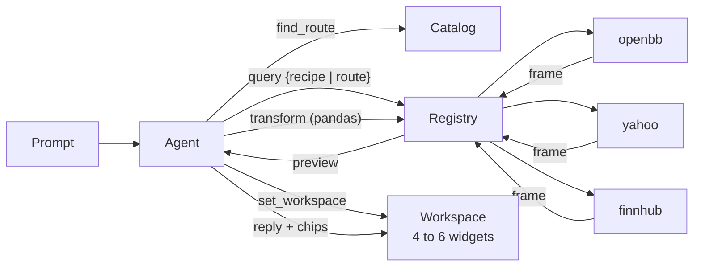

<div align="center">

# Open Terminal

**The open-source, AI-native terminal for traders.**

Ask a question. Get a live workspace of charts, tables and option chains, and an answer that points at them.<br/>
Runs on your machine, with your keys, on data sources anyone can add.

[](LICENSE)
[](package.json)
[](#quick-start)
[](#data)

[Quick start](#quick-start) · [Why](#why) · [How it works](#how-it-works) · [Data](#data) · [Extend](#extend) · [Compare](#how-it-compares) · [Roadmap](#roadmap) · [Contributing](#contributing)

</div>

<br/>


<br/>

Cursor made the code editor conversational without taking the editor away. Open Terminal does the same for the trading terminal. The prompt builds and rewrites the workspace, and the workspace stays a real terminal: every widget is a query you can open, edit and re-run by hand.

## Why

- **Ask, don't click.** "Is NVDA's drop today news or just the market?" becomes four live widgets and a two-sentence diagnosis. A follow-up rewrites the workspace. You never assemble the answer from eight tabs again.
- **Every number is traceable.** The agent cannot type a price. It can only run queries, and the reply links each claim to the widget that shows it. Figures in the reply are checked against the frames it saw.
- **Open and local.** MIT licensed. One process on localhost plus your browser. No accounts, no hosted backend, no telemetry. Keys never leave the machine.
- **Any route, not a fixed catalog.** A connector publishes its routes as descriptors (OpenBB generates 800+ from its own OpenAPI document); the agent searches them, runs them, and derives new frames from them with pandas. Twenty-four recipes cover the common questions; hand-written annotations keep the units honest.
- **Model-agnostic.** Anthropic or OpenAI through the Vercel AI SDK. The default is Claude Opus 5.5; change one line of config to swap it.
- **Works before you add a key.** Prices, charts, search, options and fundamentals come from Yahoo on first run. Add a free Finnhub key for news, or point it at a local OpenBB Platform for dozens of providers.

## How it works



1. You type a prompt. The agent has four tools: `find_route` searches the catalog of every connector's routes, `query` runs a recipe or a route, `transform` runs a pandas script over frames it already has, `set_workspace` replaces the widgets.
2. A query goes to the registry. A **recipe** names its route alternatives in order (OpenBB first, Yahoo as the fallback) and may hold a small data graph (fetch the whole chain, keep one expiration); a **route** is one endpoint of one connector, its params validated against the connector's descriptor. Results are frames: typed columns plus rows, annotated with units, cached per route.
3. The agent sees a preview of every frame it ran: the columns with their units, the first rows, and per-symbol stats. Numbers in the reply must come from here, and the server verifies them.
4. It emits a workspace, four to six widgets by default or the one or two you asked for, each a data graph rendered by a **preset**: `price`, `compare`, `curve`, `indicator`, `table`, `stat`, `facts`, `chain`, `heatmap`. Then a short reply that begins with the answer and carries chips linking to the widgets it drew on.
5. Widgets keep polling on a per-route TTL. Ask a follow-up and the workspace is rewritten. Everything is a workspace, including the one you keep for your morning check.

The nouns (workspace, widget, dataset, query, route, descriptor, catalog, recipe, transform, frame, shape, annotation, preset) are defined once in [docs/vocabulary.md](docs/vocabulary.md) and used exactly, in code, docs and commits.

<table>
<tr>
<td width="50%">

**"Is NVDA's drop today news or just the market?"**

NVDA against SPY and SMH on 5-minute bars, a candle chart, a quote table for the peers, and 24 hours of news. Reply: how much of the move is sector, and the one NVDA-specific headline.


</td>
<td width="50%">

**"Morning check on my watchlist"**

A workspace you keep. Re-run the same prompt each day: pre-market quotes, who reports today, overnight news, SPY and QQQ for the week. The watchlist carries over from the last run.


</td>
</tr>
</table>

## Quick start

```sh
npx openterminal
```

One local process. It opens `http://localhost:4242` and works with no keys: quotes, charts, search, option chains and fundamentals come from Yahoo through the built-in `yahoo` connector.

**Add an LLM key** to get the agent. Set `ANTHROPIC_API_KEY` (or `OPENAI_API_KEY`) in your environment, or write it to `~/.terminal/config.yml`:

```yaml
llm:
  provider: anthropic           # or openai
  model: claude-opus-5-5
  apiKey: sk-ant-...
```

Without one, the app explains how to add it and you can still build workspaces by hand in the widget editor (a recipe, a route from the catalog, or a transform).

**Add news** with a free [Finnhub](https://finnhub.io) key on the Data page in the app. It is saved to the same file. Finnhub also answers quotes and the earnings calendar, so tables survive a Yahoo outage.

**Add everything else** with [OpenBB Platform](https://docs.openbb.co/platform), which the `openbb` connector talks to over HTTP on your machine:

```sh
pip install "openbb[routers]" openbb-yfinance
openbb-api
```

Python 3.10 to 3.12. When the API answers at `http://127.0.0.1:6900`, its 800+ routes join the catalog, every recipe routes to it first, and Yahoo and Finnhub become fallbacks. When it is not running the miss costs nothing. yfinance, nasdaq, cboe, sec, finra, federal_reserve, bls and oecd need no key; FMP, Polygon, Intrinio, Tiingo, FRED, EIA and others take keys you keep on the OpenBB side. OpenBB is AGPL-3.0 and runs as its own process; this repo only sends it requests. Details and per-route provider overrides: [connectors/openbb/README.md](connectors/openbb/README.md).

## Data

Three connectors ship in the box. Each publishes the routes it answers as **descriptors** (path, params, providers, response fields), and the registry's **catalog** is the searchable union of them with a liveness record per route from `pnpm probe`.

| Connector | Key | Routes |
|---|---|---|
| `openbb` | none for the keyless providers | every GET route of your local OpenBB Platform API, generated from its `openapi.json` (834 on OpenBB 5.0.0), through whatever providers your install has |
| `yahoo` | none | the five yahoo-finance2 endpoints: `search`, `quote`, `chart`, `options`, `quoteSummary` (with its modules) |
| `finnhub` | free | `quote`, `company-news`, `calendar/earnings` |

A query is a **route** (`{ connector, route, params }`), a **recipe** (`{ recipe, params }`), or a **transform** (`{ inputs, code }`, pandas in a Pyodide sandbox). Frames carry a field config per column (unit, label, format, priority) from the **annotations** in `packages/core/annotations.yml`, so a fraction from one provider and a percent from another both render and read as percent. Any route, plus these recipes:

<!-- recipes:start -->
| Recipe | Params | View | Reads | What it answers |
|---|---|---|---|---|
| `search` | q | table | openbb `equity/search`, yahoo `search` + transform | Resolve a free-text name or ticker to symbols. One query per call; batch by calling it in parallel. |
| `quote` | symbols[] | stat | yahoo `quote`, openbb `equity/price/quote`, finnhub `quote` | Latest price, day change, volume, market state and extended-hours price per symbol. |
| `ohlcv` | symbols[], interval?=1m\|5m\|15m\|1h\|…, range?=1d\|5d\|1mo\|3mo\|…, start? | price | openbb `equity/price/historical`, yahoo `chart` | Price bars per symbol over a range at an interval, long format with a symbol column. |
| `news` | symbols[], limit? | table | openbb `news/company`, finnhub `company-news` + transform | Recent headlines per symbol, newest first. |
| `earnings` | symbols[], from, to | table | openbb `equity/calendar/earnings`, yahoo `quoteSummary`, finnhub `calendar/earnings` + transform | Earnings dates inside a date window; session is bmo, amc or null. The market-wide calendar, cut to the symbols. |
| `profile` | symbols[] | facts | openbb `equity/profile`, yahoo `quoteSummary` | Who the company is: name, exchange, sector, industry, market cap, employees, beta, description. |
| `metrics` | symbols[] | table | openbb `equity/fundamental/metrics`, yahoo `quoteSummary` | Valuation and quality snapshot per symbol: multiples, margins, growth, returns, leverage, yield. |
| `financials` | symbols[], period?=annual\|quarter, limit? | table | openbb `equity/fundamental/income`, openbb `equity/fundamental/cash`, openbb `equity/fundamental/balance` + transform | Statement lines per fiscal period, newest first: income, cash flow and balance sheet joined on period_ending. |
| `estimates` | symbols[] | table | openbb `equity/estimates/consensus`, yahoo `quoteSummary`, openbb `yfinance/estimates/earnings` + transform | Analyst consensus per symbol: recommendation, analyst count, price targets with upside, EPS estimates. |
| `eps_history` | symbols[], limit? | table | openbb `equity/fundamental/historical_eps`, yahoo `quoteSummary` | Past earnings per symbol, newest first: reported EPS against the estimate and the surprise. |
| `dividends` | symbols[], limit? | table | openbb `equity/fundamental/dividends`, yahoo `chart` + transform | Dividend history per symbol, newest first: ex-dividend date and cash amount per share. |
| `insiders` | symbols[], limit? | table | openbb `equity/ownership/insider_trading`, yahoo `quoteSummary` + transform | Insider transactions per symbol, newest first. |
| `institutions` | symbols[], limit? | table | openbb `equity/ownership/institutional`, yahoo `quoteSummary` + transform | Largest institutional holders per symbol from the latest filings. |
| `short_interest` | symbols[], limit? | table | openbb `equity/shorts/short_interest`, yahoo `quoteSummary` + transform | Twice-monthly short interest per symbol, newest first: shares short, change, average volume, days to cover. |
| `options` | symbol, expiration?, strikes?, type?=call\|put\|both | chain | openbb `derivatives/options/chains`, yahoo `options` + transform | Option chain for one symbol at one expiration, a strike window around the underlying. |
| `volatility` | symbols[] | stat | openbb `equity/price/quote` + transform | Implied and realized volatility snapshot per symbol: 30-day IV with its one-year range, the hv30 range, the 52-week price range. |
| `calendar` | from, to, country? | table | openbb `economy/calendar` | Economic calendar inside a date window for one country. |
| `ipos` | from, to | table | openbb `equity/calendar/ipo` | IPOs priced or expected inside a date window. |
| `movers` | list?=gainers\|losers\|active, limit?, min_price? | table | openbb `equity/screener`, openbb `nasdaq/markets/movers` | Today's top gainers, losers or most active US stocks. |
| `holdings` | symbol | table | openbb `etf/holdings`, yahoo `quoteSummary` | Top holdings of one ETF: constituent symbol, name and weight. |
| `macro` | series=treasury_3m\|treasury_2y\|treasury_10y\|treasury_30y\|…, range?=1d\|5d\|1mo\|3mo\|… | compare | openbb `fixedincome/government/treasury_rates`, openbb `fixedincome/rate/effr`, openbb `fixedincome/rate/sofr`, openbb `economy/money_measures`, openbb `economy/cpi`, openbb `economy/unemployment` + transform | One macro series over a range: treasury yields, the 10y-2y spread, fed funds, SOFR, CPI YoY, unemployment, M2. One series per dataset; compare several as datasets of one widget. |
| `yield_curve` | date? | curve | openbb `fixedincome/government/yield_curve` + transform | US Treasury yield curve on one date (the latest when omitted): maturity, years and rate, shortest first. |
| `index` | symbol?, interval?=1m\|5m\|15m\|1h\|…, range?=1d\|5d\|1mo\|3mo\|…, start? | price | openbb `index/price/historical`, yahoo `chart` | An index's price history (^GSPC for the S&P 500, ^NDX, ^VIX); SPY, QQQ are the tradables. |
| `screener` | sector?, industry?, mktcap_min?, mktcap_max?, preset?, limit?, price_min? | table | openbb `equity/screener` | The whole market screened on yfinance: a sector (technology, healthcare, financial-services, energy, …), an industry, a market-cap floor or ceiling in dollars and a price floor, or a preset (day_gainers, most_actives, undervalued_large_caps, …). No P/E filter on the route: cut on trailingPE with a transform. |
<!-- recipes:end -->

The table is generated from `packages/core/recipes.yml` by `pnpm readme:recipes`; a test fails when it drifts. Recipes are data: a title template, a param schema, a preset, ordered route alternatives with param mappings, and optionally a data graph with a pandas step. Promote any widget you like to a user recipe from the Data page; it lands in `~/.terminal/recipes.yml`.

Nine **presets** render any frame whose shape fits: `price` (candles or a line, volume, event markers, levels, bands), `compare` (lines, optionally rebased to 100), `curve` (a numeric x axis: yield curve, IV by strike), `indicator` (RSI, MACD, moving averages in their own panes), `table`, `stat` (one headline number per symbol with its change), `facts` (a one-row card), `chain` (calls, strikes, puts), `heatmap`.

## Extend

The whole plugin surface is one function. A connector is a package whose default export is `defineConnector`, with `descriptors()` (the routes it answers, as a JSON file or generated) and `call(route, params, ctx)`. Params arrive validated against the descriptor; `inferFrame` builds the frame from the provider's rows; the annotations say what the columns mean.

```ts
import { z } from 'zod'
import { defineConnector, inferFrame, parseDescriptors } from '@openterminal/core'
import descriptors from './descriptors.json' with { type: 'json' }

export default defineConnector({
  name: 'shape',
  config: z.object({ apiKey: z.string().min(1) }),
  descriptors: () => parseDescriptors(descriptors),
  call: async (route, params, ctx) => {
    const rows = (await ctx.http.get(`https://api.shape.dev/${route}?symbol=${params.symbol}`, { headers: { 'X-Token': ctx.config.apiKey }, signal: ctx.signal })) as Record<string, unknown>[]
    return inferFrame(rows, { connector: 'shape' }, { descriptor: descriptors.find((d) => d.route === route) })
  },
})
```

Register it in `~/.terminal/config.yml`, and its routes are in the catalog on the next prompt. Tests run against recorded fixtures, never the network. The full guide, including the descriptor format, annotations, the OpenAPI generator, errors and fallback, and a worked example, is [docs/writing-a-connector.md](docs/writing-a-connector.md).

What else is open to change:

- **Models.** Any Anthropic or OpenAI model id the installed provider packages know. The agent prompt lives in `packages/server/src/agent/prompt.ts` and is plain text.
- **Recipes and annotations.** Data files: `packages/core/recipes.yml` and `packages/core/annotations.yml`, plus your own under `~/.terminal/`. A new question that one route answers is a recipe, not code.
- **Presets.** In `packages/core/src/presets.ts`, a pure function from options and field config to panes and layers; the renderers in `packages/web/src/views` know marks and panes only.

## Development

Node 22 and pnpm.

```sh
pnpm install
pnpm dev          # server on :4242, web on :5173, UI preview on :5174
pnpm typecheck
pnpm lint
pnpm test         # Vitest; connectors run against recorded fixtures, never the network
pnpm query ohlcv symbols=AAPL,MSFT range=3mo                  # print a recipe's frame without the app
pnpm query options symbol=NVDA strikes=5
pnpm query openbb equity/price/quote symbol=NVDA provider=yfinance   # one route of one connector
pnpm query openbb --routes bond                               # search a connector's routes
pnpm probe        # call every route once and record liveness (OpenBB: about ten minutes at --concurrency=4)
pnpm bench        # run scripts/prompts.json against a running server and score the replies
```

| Path | What lives there |
|---|---|
| `packages/core` | the contract: frames, descriptors, catalog, queries, recipes, annotations, shapes, presets, registry, protocol |
| `packages/server` | loader, HTTP and WebSocket API, SQLite store, transform engine (Pyodide), agent |
| `packages/ui` | design system |
| `packages/web` | React app, the editor and the Data page, views |
| `packages/cli` | the `npx` entry point |
| `connectors/*` | `openbb`, `yahoo`, `finnhub` |
| `deploy/` | systemd units for an always-on instance |
| `docs/` | [architecture](docs/architecture.md), [vocabulary](docs/vocabulary.md), [writing a connector](docs/writing-a-connector.md), probe and bench notes |

The plan, the decisions behind it, and the handoff for whoever works on it next are in [PLAN.md](PLAN.md). How a change becomes a PR, for people and agents alike, is in [docs/shipping.md](docs/shipping.md).

## How it compares

| | Open Terminal | Bloomberg | ChatGPT / Perplexity | OpenBB | Instinct |
|---|---|---|---|---|---|
| Ask a question, get live views | yes | no | prose only | partly, in the paid workspace | yes |
| Every number traceable to data | yes | yes | no | yes | unclear |
| Open source | MIT, the whole thing | no | no | data layer only | no |
| Runs locally, your keys | yes | no | no | partly | no |
| Add a data source yourself | one file | no | no | yes | no |
| Price | free | ~$25k/yr | $20/mo | free + paid workspace | waitlist |

## Roadmap

Cut on purpose, each checked against the three use cases above. Add nothing back without a use case that needs it.

- Diff or accept/reject of agent edits: a prompt overwrites the workspace
- Dragging and resizing widgets: a CSS grid auto-packs widgets by size and content
- Real-time streaming (widgets poll on a per-route TTL)
- Plugin spine for views and agents: the loader is swappable later, `defineConnector` does not change
- Alerts (a transform with a condition over a dataset), automations, scheduling
- Order execution and broker connectors
- Crypto connectors and non-US tickers
- Desktop packaging, auth, hosting, multi-user

## Contributing

The easiest contribution is a connector: a descriptor file and a `call`, tested against recorded fixtures. The next easiest is a recipe or an annotation: a few lines of YAML. Start with [docs/writing-a-connector.md](docs/writing-a-connector.md). Use the words in [docs/vocabulary.md](docs/vocabulary.md) exactly, in code, docs and commit messages. [docs/architecture.md](docs/architecture.md) is the tour for everything else.

## License

MIT.

Type: UI text is [Geist](https://vercel.com/font) (OFL, via Fontsource); numbers and code are [Ioskeley Mono](https://github.com/ahatem/IoskeleyMono) (OFL), an [Iosevka](https://typeof.net/Iosevka/) build vendored in `packages/ui/src/fonts`. A locally installed Berkeley Mono is used first when you have it.
