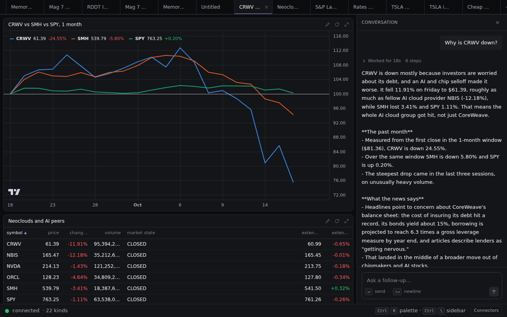
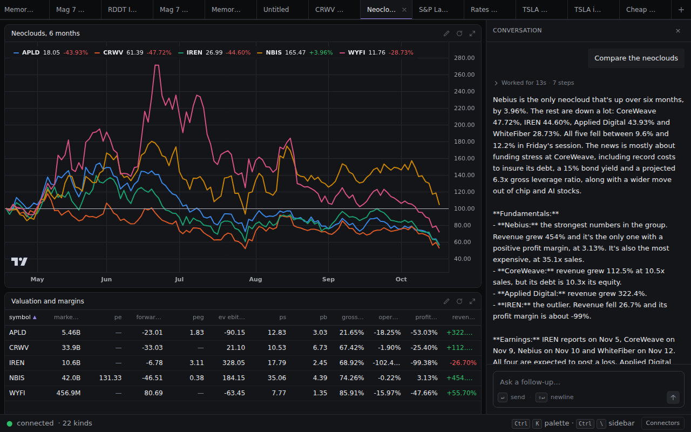
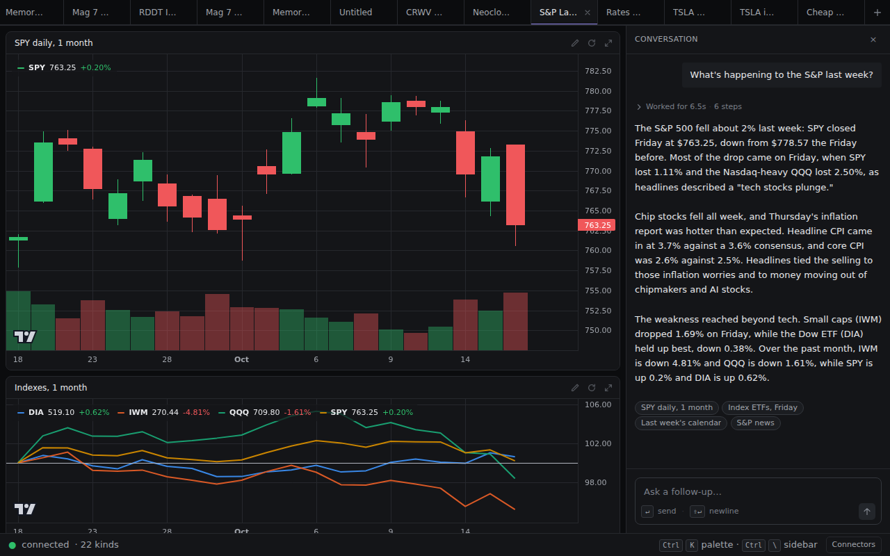
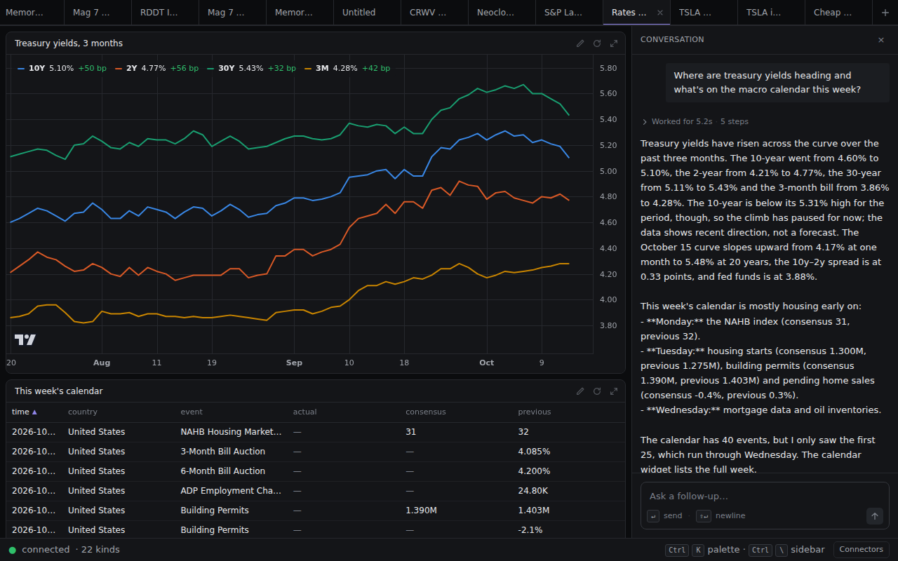
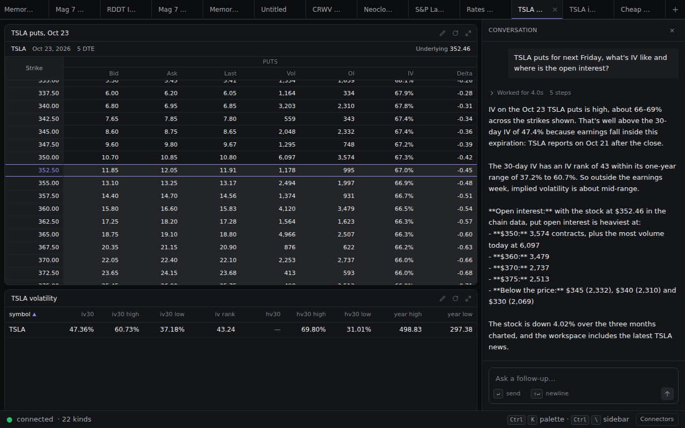
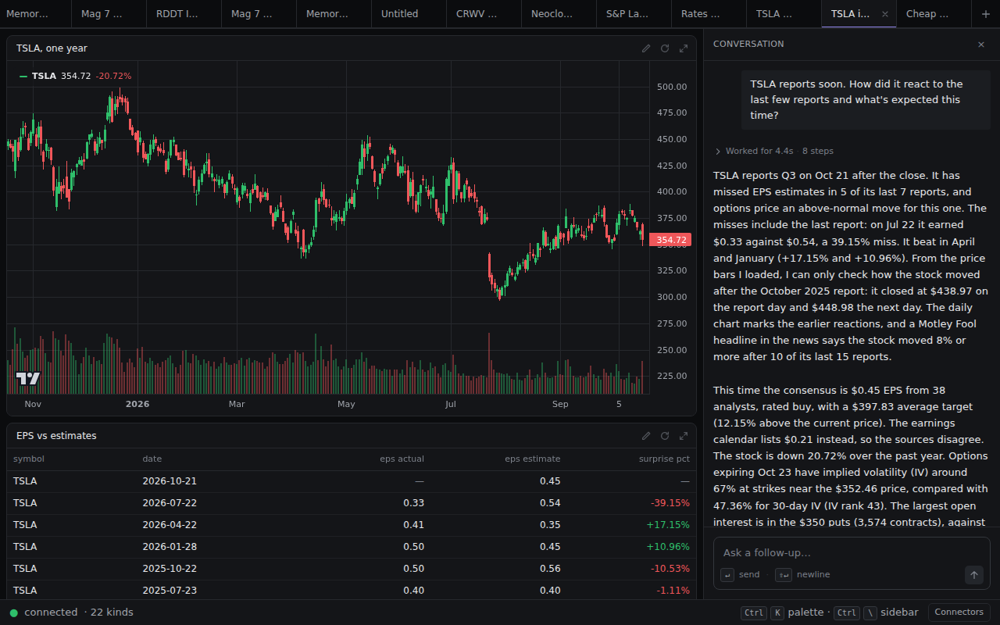
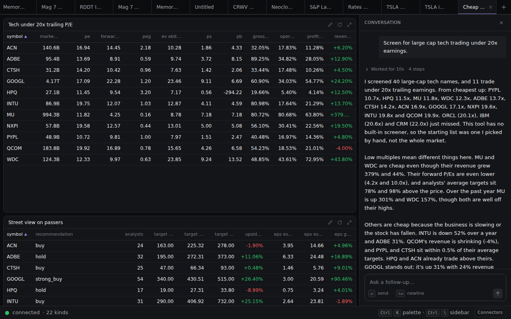

# Prompt bench v2, strict: seven use cases with screenshots (2026-10-18)

The v1 bench (`prompt-bench-2026-10-18.md`) graded behaviour and arithmetic and was judged not strict. This one grades what a retail trader gets: did the reply teach them what they asked, can they see it in the widgets, and could they act on it. The grader does not care which data sources exist. If a prompt needs a fact and the product cannot show it, or derives it wrongly, that criterion fails.

Setup: a scratch server built from this branch (`PORT=4263`, `TERMINAL_HOME` a copy of `~/.terminal`), Opus 5.5, connectors openbb → yahoo → finnhub, OpenBB 5.0.0 on 6900. Run on Sunday 2026-10-18, so "Friday" is 2026-10-16 and "last week" is Oct 12 to 16. Prompts are the `v2` group in `scripts/prompts.json`; rerun with `BASE=http://127.0.0.1:4263 pnpm bench -- --group v2 --out <dir>`. The bench now prints a verification block after every reply (per widget: the frame's connector and rows, per-symbol first and last close with the change, the rows a reply may quote), which is what the "numbers verified" lines below were checked against. Screenshots are 1280x800 headless Chromium with the conversation panel open, one per dashboard, in `docs/screenshots/bench-v2-<slug>.png`; the widgets below the fold were checked through the DOM (cell height, table height, hidden columns, sideways overflow) rather than by eye.

## Rubric

Written before the runs. Three questions a trader has for any answer, split into seven named criteria. Each is pass or fail per prompt.

What they must learn:

- **A. Answer first.** The first sentence states the finding with a number. No plan, no preamble.
- **F. Facts complete and correct.** Every fact the prompt needs is there and right. For "why is X down": the move, the peers, the catalyst, and the data behind the catalyst. For a comparison: growth, margins, debt, valuation, performance. For "last week": the level, the move, the leaders, the events of that week. A fact told from a headline instead of data counts as missing. A fact the product cannot show or derive correctly counts as missing.

What they must see to trust it:

- **N. Numbers verified.** Every figure in the reply is in a frame the bench recorded, with the right baseline. A derived figure is right only if the derivation is (trailing P/E is price over trailing twelve-month EPS, nothing looser).
- **W. Widgets right.** The widget set is the set the question needs: nothing essential missing, nothing that the reply does not use, the hero is the view that answers the question.
- **R. Rendering clean.** Every cell is full: no table using less than two thirds of its cell, no column the answer relies on hidden, no clipped or sideways-scrolling content, no wrong or stale data in a cell.
- **C. Cites and plain.** The reply ends with chips for the widgets it draws on and is plain prose (the prompt forbids markdown headings, bullets and bold).

What they would do next:

- **T. Time window and baseline.** The window in the widgets is the window in the question, and period changes are measured from the close before the period (product rule 4, prompt rule 2).

Verdict: **pass** when all seven pass; **partial** when the trader learns the right answer (A, F, N, T pass) but the dashboard lets it down (W, R or C fail); **fail** when any of A, F, N or T fails.

## Scorecard

| # | Prompt | A | F | N | W | R | C | T | Verdict | Top reason |
|---|---|---|---|---|---|---|---|---|---|---|
| 1 | Why is CRWV down? | pass | fail | pass | fail | fail | fail | fail | **fail** | The debt story is told from headlines; no bond yield, spread or CDS widget. Another workspace's frame was shown in the "Next report" cell. |
| 2 | Compare the neoclouds | pass | fail | pass | fail | fail | fail | pass | **fail** | No absolute debt, cash or FCF, no estimates (both kinds exist); debt/equity is a hidden column. |
| 3 | What's happening to the S&P last week? | pass | fail | pass | fail | fail | pass | fail | **fail** | No sectors or leaders; SPY stands in for the index; hero shows a month, not the week; PPI and retail sales were in the frame and not mentioned. |
| 4 | Where are treasury yields heading and what's on the macro calendar this week? | pass | fail | fail | pass | fail | fail | pass | **fail** | Weekdays wrong: NAHB is Tuesday, not Monday; housing starts Wednesday, not Tuesday. The calendar's time column is truncated to "2026-10…" so the reader cannot check. |
| 5 | TSLA puts for next Friday, what's IV like and where is the open interest? | pass | pass | pass | fail | fail | fail | pass | **partial** | Right answer (IV 66 to 69% vs IV30 47%, OI at 350/360/370). Two one-row tables 73% blank; news widget never queried or cited; two prices for TSLA on one screen. |
| 6 | TSLA reports soon. How did it react to the last few reports and what's expected this time? | pass | fail | pass | fail | fail | pass | pass | **fail** | Reaction given for one of seven reports; the other three were in the ohlcv frame (−3.5%, −3.6%, −14.5%) and never shown. |
| 7 | Screen for large cap tech trading under 20x earnings. | pass | fail | pass | fail | fail | pass | pass | **fail** | A hand-picked 40-name universe, not a screen: SKHY 8.7x, UBER 15.4x, SNDK 17.6x (all over $100B) are missing. Three metrics tables, one of them a 40-row dump. |

0 pass, 1 partial, 6 fail. No run crashed, timed out or produced a frame error; 14 to 37 s to the reply. Every figure in every reply traces to a recorded frame, with two exceptions noted under 4 (weekday labels, not in any frame) and 5 (a stale underlying price that is in a frame but contradicts the quote beside it). The v1 defects "markdown bold despite the rule", "news dominated by one symbol" and "the 25-row preview cap shows in replies" all recurred.

## Per prompt

### 1. Why is CRWV down? — fail

Widgets (5): CRWV vs SMH vs SPY 1mo normalized (lg hero), quote table CRWV NBIS NVDA ORCL SMH SPY (md), CRWV news (md), insider transactions (md), next report (sm). 32.5 s.

Reply, first sentence: "CRWV is down mostly because investors are worried about its debt, and an AI and chip selloff made it worse."

Numbers verified: CRWV −11.91% Friday to 61.39, NBIS −12.18%, SMH −3.41%, SPY −1.11% (quote frame); CRWV 81.36 → 61.39 = −24.55%, SMH −5.80%, SPY +0.20% over the 21 bars (ohlcv frame, first bar to last bar); CFO sold 15,388 at 79.95 and 7,191 at 80.51 on Oct 12, CRO sold on Oct 12 and 13 at 77.18 to 80.36 (insiders frame); next report Nov 9, EPS estimate −1.57 (earnings frame). The three heaviest sessions were Oct 14 (close 65.78, 111M shares), Oct 15 (69.69, 131M) and Oct 16 (61.39, 95M), so "the last three sessions on unusually heavy volume" is right.

- **F fail.** The answer is "its debt", and the only evidence is headlines ("its bonds yield about 15%", "the cost of insuring its debt hit a record", "6.3x gross leverage"). Nothing on screen shows a yield, a spread or a rating. The data exists one route away: OpenBB's finra provider serves FINRA TRACE, and `GET /api/v1/fixedincome/corporate/bond_prices?provider=finra&issuer_name=coreweave` returned twelve CoreWeave bonds with last sale yield, price, coupon, maturity and ratings (the 9.25% 2030s at 87.75, yield 13.63%, Moody's B1, S&P B; the 9.75% 2031s at 14.85%); `/finra/fixedincome/bond_historical?cusip=21873SAB4` returned the daily series, which is the story the reply could not show: that bond's yield went 11.45% (Sep 29) → 11.94% (Oct 8) → 13.05% (Oct 13) → 14.02% (Oct 14) → 13.63% (Oct 15). Nothing on options positioning either (the `options` and `volatility` kinds exist and were not used). CDS levels are not available from any keyless source.
- **W fail.** Missing: a bond widget, options or IV. Present but unused by the reply: nothing (every widget is cited), but the sm earnings cell holds one row.
- **R fail.** (1) The "Next report" cell displayed the earnings frame of a different workspace: the DOM showed WDC Oct 22, STX Oct 27, SNDK Oct 29, which is widget `w5` of the "Memory rollover check" tab, while this workspace's `w5` is `earnings CRWV` and its frame has one row. Frames in the web app are keyed by widget id and ids are `w1..wN` in every workspace, so switching tabs shows whichever `w5` arrived last and skips the fetch because a frame exists. That is wrong data in a cell. (2) The insiders table lists the same lot twice, as `other` and as `sell` (Oct 11, 42,772 shares; Oct 6, 1,460 shares), 6 of 20 rows. (3) One-row earnings table in a 240px cell, 46% blank.
- **C fail.** The reply has `**The past month**`, `**What the news says**`, `**Other things to know**` and bullet lists, rendered as literal asterisks in the panel.
- **T fail.** The month change was measured "from the first close in the 1-month window ($81.36)", which is the first bar inside the window, not the close before it (rule 2); the reply says so, which is honest, but the baseline is still wrong.

Fixes: a `bonds` kind (data we have access to, no kind: proposal 1); frames keyed per workspace (UI defect: proposal 2); a `prevClose` stat in previews so the baseline is right by construction (proposal 9); insider dedup (proposal 14); a stat card for one-row frames (proposal 4); a prompt rule that "why is X down" includes `options` or `volatility` when they are answerable (prompt rule).

### 2. Compare the neoclouds — fail

Widgets (5): CRWV NBIS IREN APLD WYFI 6mo normalized (lg), metrics (md), quote (md), upcoming earnings (sm), news (md). 25.4 s. The agent picked the basket itself (search for CoreWeave, Nebius, IREN, Applied Digital, Lambda, WhiteFiber, Cipher Mining; Lambda is not listed, said so).

Numbers verified: NBIS +3.96%, CRWV −47.72%, IREN −44.60%, APLD −43.93%, WYFI −28.73% over 126 bars (ohlcv); Friday −9.61% to −12.18% (quote); NBIS revenue growth 454, profit margin 3.13, P/S 35.06; CRWV revenue growth 112.5, P/S 10.53, debt/equity 10.27; APLD 322.4; IREN −26.7 and −99.38 (metrics); IREN Nov 5, CRWV Nov 9, NBIS Nov 10, WYFI Nov 12, all negative estimates (earnings).

- **F fail.** "Compare" for a group whose story is leverage needs debt in dollars, cash, free cash flow and capex, and what the Street expects. `financials` (debt, cash, FCF, capex per period) and `estimates` (targets, growth) both exist and were not queried. Debt appears only as the `debt_to_equity` ratio, and that column is hidden (see R).
- **W fail.** No `financials`, no `estimates`. The news table is 16 of 20 rows CRWV (v1 finding 5, unchanged), so it is not a group news widget.
- **R fail.** The metrics table in an md cell shows 12 of 16 columns and hides `earnings_growth`, `roe`, `debt_to_equity`, `dividend_yield`; the reply's "its debt is 10.3x its equity" cannot be seen anywhere. The openbb quote frame has no `market_state`, `extended_price` or `extended_change_pct` for these names, so three columns of dashes. The sm earnings table is 32% blank.
- **C fail.** `**Fundamentals:**`, `**Nebius:**` and bullets.

Fixes: a prompt rule for comparisons (metrics + financials + estimates, debt in dollars when the question is leverage) (data we have, not shown); table column selection by the agent (`view.columns`) so the relevant ratio is visible (proposal 13); per-symbol news share (proposal 12); openbb quote filling extended fields from yahoo per symbol, or tables dropping columns that are null in every row (proposal 4).

### 3. What's happening to the S&P last week? — fail

Widgets (5): SPY daily candles 1mo (lg), SPY QQQ IWM DIA 1mo normalized (md), index ETFs quote (sm), last week's calendar Oct 12 to 16 (md), SPY news (md). 21.2 s.

Numbers verified: SPY 778.57 (Oct 9) → 763.25 (Oct 16) = −1.97%, "about 2%", baseline right; Friday SPY −1.11%, QQQ −2.50%, IWM −1.69%, DIA −0.38% (quote); month IWM −4.81%, QQQ −1.61%, SPY +0.20%, DIA +0.62% (ohlcv); CPI 3.7% vs 3.6% consensus, core 2.6% vs 2.5% on Thursday Oct 15 (calendar).

- **F fail.** No sectors, no leaders and laggards: the question "what's happening" to an index is answered by which parts moved, and nothing on screen says. SPY is a proxy for the level; the index itself is one symbol away (`pnpm query ohlcv ^GSPC 1d 1mo` works: 7805.45 on Oct 9 → 7659.44 on Oct 16, −1.87%) and was not used. The calendar frame (78 rows) also held Friday's PPI 6.3% vs 5.3% consensus and core PPI 5.0% vs 4.4%, retail sales 0.8% vs 0.3%, and the Philly Fed at 20.9 vs 28.2; the reply names only CPI because the preview stops at 25 rows (the first 25 are Tuesday and Wednesday Fed speakers and IMF meetings).
- **W fail.** No sector widget (11 SPDR sector ETFs through `ohlcv`, 5d normalized, would do it with the kinds we have). The calendar is mostly noise for this question (Fed speakers, IMF meetings, Redbook) and the one row that matters is below the fold.
- **R fail.** The calendar's `time` column is truncated to "2026-10…" at this width (the day and hour are the point of a calendar). The sm quote table is 32% blank.
- **T fail.** The hero is a month of candles with no marking of the week; "last week" is five bars at the right edge. The weekly baseline in the reply is right.

Fixes: a prompt rule that "the S&P", "the Nasdaq", "the Dow" chart the index symbol (`^GSPC`, `^IXIC`, `^DJI`) and quote the ETF (data we have, not shown); a sectors preset or a derived `sector_performance` table (proposal 10); the calendar time column (proposal 3); preview size or sorting for calendars (proposal 5); a 5d hero for "last week" (prompt rule).

### 4. Where are treasury yields heading and what's on the macro calendar this week? — fail

Widgets (4): treasury 3m 2y 10y 30y 3mo (lg series with basis-point legends), this week's calendar Oct 18 to 25 (md), yield curve (md table), 10y-2y spread and fed funds 1y (md series). 17.5 s.

Numbers verified: 10y 4.60 → 5.10 (high 5.31), 2y 4.21 → 4.77, 30y 5.11 → 5.43, 3m 3.86 → 4.28 over Jul 20 to Oct 15 (macro); curve Oct 15 from 4.17 at 1M to 5.48 at 20Y, 5.43 at 30Y (yield_curve); spread 0.33, fed funds 3.88 (macro); NAHB consensus 31 previous 32, housing starts 1.300M vs 1.275M, permits 1.390M vs 1.403M, pending home sales −0.4% vs 0.3% (calendar).

- **F fail, N fail.** The weekday labels are wrong. The frame has NAHB at 2026-10-20 14:00 UTC, which is Tuesday; housing starts and permits on Wednesday Oct 21; mortgage data and oil inventories on Thursday Oct 22. The reply says Monday, Tuesday, Wednesday. A trader who sets an alarm from this reply is a day early. Nothing in the frame says "Monday"; the model computed the weekday and got it wrong (the system prompt gives today's weekday only). It also saw 25 of 40 rows and so never mentions Friday's jobless claims and the 20-year bond auction, the one rates event of the week.
- **W pass.** This is the right set for the question; the yield curve as a table instead of a curve is a view gap, not a widget gap.
- **R fail.** The calendar `time` column shows "2026-10…" for every row, so the reader cannot see the day or hour, which is the only thing that would have caught the mistake above. The spread and fed funds share one axis in basis points, which works.
- **C fail.** `**Monday:**` bullets.

Fixes: calendar time column with weekday and ET time, and a `weekday` in the preview rows for `calendar` so the model never computes one (UI defect and prompt rule: proposal 3); a larger preview for `calendar` or server-side grouping by day (proposal 5); a curve view for `yield_curve` (proposal 15).

### 5. TSLA puts for next Friday, what's IV like and where is the open interest? — partial

Widgets (5): TSLA Oct 23 puts, 10 strikes each side (lg chain), volatility (md), next report (sm), TSLA daily 3mo (md), TSLA news (md). 15.7 s.

Numbers verified: IV 68.87 at 327.5 down to 66.02 at 375 (options); IV30 47.36, range 37.18 to 60.73, IV rank 43.24 (volatility); report Oct 21 amc (earnings); OI 3,574 at 350 with 6,097 volume, 3,479 at 360, 2,737 at 370, 2,513 at 375, 2,332 at 345, 2,310 at 340, 2,069 at 330 (options); −4.02% over 64 bars (ohlcv).

- **F pass.** IV level, where it sits against IV30 and its one-year range, why (earnings inside the expiry), and the OI map. The missing derivation is the implied move (ATM straddle over spot; roughly 7% here, twice the 352.5 put's 11.91 over 352.46), which is what a put buyer into earnings compares IV against; a nice-to-have for this wording.
- **W fail.** The news widget was never queried (no `news` step) and the reply only says "the workspace includes the latest TSLA news". Two single-row tables.
- **R fail.** Volatility and earnings are one-row tables in 240px cells, 73% blank each. The chain header says "Underlying 352.46" (cboe's snapshot) while the candle beside it closes at 354.72 and `quote` says 354.72; the reply picks the chain's price ("with the stock at $352.46"). The chain in the lg cell opens scrolled to the underlying, so the 327.5 to 335 strikes are hidden until the user scrolls, which is fine for 20 rows but means the screenshot shows 16.
- **C fail.** `**Open interest:**` bullets.

Fixes: stat cards for one-row frames (proposal 4); the chain's underlying marker from the quote when the two disagree, with the chain's snapshot time shown (proposal 11); an `implied_move` stat on the options preview (proposal 16); do not emit a widget that was not queried, or query it (prompt rule).

### 6. TSLA reports soon. How did it react to the last few reports and what's expected this time? — fail

Widgets (6): TSLA 1y candles (lg), EPS vs estimates (md), Street consensus (md), Oct 23 chain both sides (md), volatility (sm), news (md). 26.4 s.

Numbers verified: 5 misses in the last 7 (Jul 22 0.33 vs 0.54 = −39.15%; Apr 22 +17.15%; Jan 28 +10.96%; Oct 22 2025 −10.53%; Jul 23 2025 −1.11%; Apr 22 2025 −34.89%; Jan 29 2025 −5.11%) (eps_history); close 438.97 on 2025-10-22 and 448.98 the next day (ohlcv); consensus 0.45 from 38 analysts, buy, target 397.83, +12.15% (estimates); the earnings calendar's 0.21 vs the estimates' 0.45, flagged as a disagreement; −20.72% over the year; 350 puts OI 3,574 vs 926 calls (options).

- **F fail.** The question is the reaction to the last few reports. The reply gives one (October 2025, +2.3%) and says it cannot check the rest because of "the price bars I loaded", meaning the 25-row preview of a 250-bar frame. The bars were in the frame: Jan 28 → 29 431.46 → 416.56 (−3.5%), Apr 22 → 23 387.51 → 373.72 (−3.6%), Jul 22 → 23 374.01 → 319.69 (−14.5%). Nothing on the dashboard shows a reaction either; "the daily chart marks the earlier reactions" is not true, the candle chart has no event markers.
- **W fail.** No widget answers the main question. The chain in an md cell is a second options widget the question did not ask for.
- **R fail.** Estimates and volatility are one-row tables, 73% blank. The chain in an md cell shows 9 of 20 rows.
- **C pass.** Plain prose, six chips.

Fixes: an earnings reaction derivation, either columns on `eps_history` (`close_before`, `close_after`, `reaction_pct`, joined in core from an ohlcv frame) or a new `earnings_reactions` kind (proposal 6); event markers on the candle chart for report dates (view feature); stat cards (proposal 4).

### 7. Screen for large cap tech trading under 20x earnings. — fail

Widgets (5): tech under 20x trailing P/E, 11 names (lg metrics table), Street view on passers (md estimates), passers 1y weekly normalized (md), near misses ORCL IBM CRM (md metrics), full screened universe, 40 names (md metrics). 37.1 s.

Numbers verified: PYPL 10.72, HPQ 11.45, MU 11.82, WDC 12.33, ADBE 13.69, CTSH 14.20, ACN 16.94, GOOGL 17.09, NXPI 19.58, INTU 19.75, QCOM 19.92; ORCL 20.10, IBM 20.63, CRM 22.02 (metrics `pe`, which the openbb connector takes from yfinance `pe_ratio`, the trailing P/E: price over trailing twelve-month EPS, the correct derivation; MU 878.84 / 74.33 = 11.82 checks); forward P/E MU 4.25, WDC 9.97; targets +77.57% and +97.84% (estimates); MU +301.26%, WDC +156.51%, INTU −52.40%, ADBE −30.64%, GOOGL +31.04% over 52 weekly bars (ohlcv).

- **F fail.** It is not a screen. The agent chose 40 tickers by hand and filtered them, and said so ("This tool has no built-in screener"). Run against the real universe (OpenBB `equity/screener?provider=yfinance&sector=technology&mktcap_min=100000000000`, 43 rows), the large caps under 20x trailing are SKHY 8.70, MU 11.82, WDC 12.33, UBER 15.43, ACN 16.94, SNDK 17.62, QCOM 19.92. Three of the seven over $100B are missing from the answer (SKHY, UBER, SNDK), and the ones below $100B that the agent found (PYPL, HPQ, CTSH, ADBE, NXPI, INTU) depend on where "large cap" starts. The trailing P/E itself is derived correctly; the universe is not.
- **W fail.** Three metrics tables for one question; the 40-row "full screened universe" is a dump nobody asked for and is not cited.
- **R fail.** The hero table is 11 rows in a 456px body, 26% blank; "near misses" is three rows, 46% blank; both hide `earnings_growth`, `roe`, `debt_to_equity`, `dividend_yield`.
- **C pass.** Plain prose, chips w1 to w4.

Fixes: a `screener` kind over the yfinance screener (proposal 7); until then a prompt rule that the reply must open with "from a hand-picked list of N names" rather than "I screened" (prompt rule).

## What is missing, in three piles

**Data we do not have (no kind, and in two cases no keyless source).**

- Corporate bond prices and yields per issuer and per CUSIP, with ratings and daily history. Source verified live: OpenBB finra provider, FINRA TRACE (`fixedincome/corporate/bond_prices`, `finra/fixedincome/bond_historical`). Needed by 1.
- CDS spreads. No keyless source; the reply's "cost of insuring its debt hit a record" stays a headline.
- A screener over the whole market with fundamental filters. Source verified live: OpenBB `equity/screener` (yfinance, nasdaq). Needed by 7.
- Sector performance as a table. Derivable from `ohlcv` on the eleven sector ETFs; yfinance `sectors/overview` has weights but no returns. Needed by 3.
- Earnings reactions (close before and after each report). Derivable in core from `eps_history` dates and an `ohlcv` frame. Needed by 6.
- Implied move from the chain. Derivable from the `options` frame. Wanted by 5.
- Event markers on charts (report dates, calendar events). A view feature. Wanted by 6 and 3.

**Data we have but did not show.**

- `financials` and `estimates` in the neocloud comparison (2).
- The index symbol `^GSPC` for "the S&P" (3).
- Calendar rows past the 25-row preview: PPI, retail sales, Philly Fed (3); Friday's claims and the 20-year auction (4).
- The bars around the other three report dates in a 250-bar frame (6).
- `options` and `volatility` for a stock whose selloff is a credit story (1).
- `debt_to_equity`, hidden by column priority in an md cell (2, 7).

**UI defects.**

- Frames keyed by widget id leak across workspaces: a tab shows another tab's data for a widget with the same id and skips the fetch (1; reproducible on any two workspaces with a `w5`).
- Calendar `time` column truncated to "2026-10…", no weekday, no hour (3, 4).
- One-row tables in full-height cells: 73% blank for `volatility`, `estimates`, single-symbol `earnings` (1, 5, 6).
- Markdown bold and bullets rendered as literal asterisks in the panel (1, 2, 4, 5).
- Two prices for one stock: the chain's `underlying_price` (cboe snapshot, 352.46) against the quote and candle close (354.72) (5, 6).
- Duplicate insider rows (`other` and `sell` for the same lot) (1).
- News tables dominated by one symbol, 16 of 20 (2).
- Empty columns when the first connector has no value for them (openbb quote on stocks: `market_state`, `extended_*` dashes) (2).

## Proposed features, ranked

Effort: S is hours, M is a day or two, L is more. Ranked by how many fails it clears times how bad the fail is.

| # | Proposal | Clears | Effort |
|---|---|---|---|
| 1 | **`bonds` kind.** Params `symbols[]` (issuer resolved from `profile.name`, TRACE symbols also carry the equity ticker as a prefix: `CRWV6083302`) or `cusips[]`, `limit`. Columns `symbol, cusip, coupon, maturity, price, yield, price_change_pct, rating_moodys, rating_sp, callable, convertible, last_trade`. Source: OpenBB `fixedincome/corporate/bond_prices?provider=finra&issuer_name=`. Plus `bond_history` (params `cusip`, `range`; columns `cusip, time, price, yield`) over `finra/fixedincome/bond_historical`, rendered by `series` keyed on `cusip` like `macro` on `series`. Prompt rule: "why is X down" on a levered name adds `bonds`. | 1 (F, W) | M |
| 2 | **Frames keyed per workspace.** Either `frames[workspaceId][widgetId]` in `packages/web/src/state.ts` and the `frame` message carrying `workspaceId`, or server-assigned globally unique widget ids. Add a test that two workspaces with `w1` do not share a frame. | 1 (R), and any tab switch | S |
| 3 | **Calendar column and preview.** `time` renders as `Tue 10:00` ET in a fixed-width column; `calendar` previews carry a `weekday` column and are grouped by day; the prompt tells the model to copy weekday labels from the frame. | 3, 4 (R, N) | S |
| 4 | **Stat card for one-row frames.** `TableView` switches to a label/value grid when a frame has one row, or a `{ type: 'stats' }` view the agent can pick; and `DataTable` drops columns that are null in every row. | 1, 2, 5, 6 (R) | S to M |
| 5 | **Preview size by kind, or sort and page in `query`.** Raise the 25-row cap for small kinds (`calendar` to 100, `eps_history`, `yield_curve`), or add `sort`/`columns` to the `query` tool so the model can ask for the bars around dates it cares about. | 3, 4, 6 (F) | S / M |
| 6 | **Earnings reactions.** `eps_history` gains `close_before, close_after, reaction_pct` (core joins an `ohlcv 1d 1y` frame on report dates; connectors unchanged), or a derived `earnings_reactions` kind. Candle view gets event markers from an `events` prop. | 6 (F, W) | M |
| 7 | **`screener` kind.** Params `sector?, market_cap_min?, pe_max?, forward_pe_max?, ps_max?, dividend_yield_min?, limit`. Columns `symbol, name, price, change_pct, market_cap, pe, forward_pe, eps_ttm, dividend_yield, sector`. Source: OpenBB `equity/screener?provider=yfinance` (sector enum lowercase; `mktcap_min`; filters applied in the connector on `trailingPE`, which is TTM). | 7 (F, W) | M |
| 8 | **Plain replies.** Render the reply's markdown in the panel (bold, lists) or strip `**` and leading `- ` server-side before `done`; the prompt rule alone fails in 4 of 7 runs. | 1, 2, 4, 5 (C) | S |
| 9 | **`prevClose` in ohlcv previews.** Connectors fetch one bar before the range and the preview reports `changePct` from it; the reply's baseline is then right by construction and rule 2 can go. | 1 (T) | S |
| 10 | **Index symbols and sectors.** Prompt rule: "the S&P / Nasdaq / Dow" chart `^GSPC / ^IXIC / ^DJI` and quote `SPY / QQQ / DIA`; "what happened to the market" adds an 11-sector-ETF `ohlcv` 5d normalized widget. Later, a derived `sector_performance` table (symbol, name, change_1d, change_5d, change_1mo) from the same bars. | 3 (F, W, T) | S, then M |
| 11 | **One price per stock.** The chain view takes the underlying marker from the workspace's `quote` when it has one, and shows the chain's snapshot time in its header. | 5, 6 (R) | S |
| 12 | **News share per symbol.** Round-robin by symbol then time in the openbb and finnhub news handlers (v1 finding 5). | 2 (W) | S |
| 13 | **Agent-chosen table columns.** `view.columns?: string[]` on tables, so the agent puts `debt_to_equity` in a leverage comparison and `DataTable` honours it before the priority order. | 2, 7 (R) | S to M |
| 14 | **Insider dedup.** Collapse `other` and `sell` rows with the same date, name and shares. | 1 (R) | S |
| 15 | **Curve view for `yield_curve`.** A `series` over `years` on the x axis, or `{ type: 'curve' }`. | 4 (view) | M |
| 16 | **Implied move stat.** The `options` preview adds `implied_move_pct` from the ATM straddle over the underlying. | 5 (F nice-to-have) | S |

Proposals 2, 3, 8 and 9 are the cheapest and three of them are correctness, not polish: wrong data in a cell, wrong weekdays, wrong baseline. Proposal 1 is the one new data kind this bench proves a need for, and the source is already running on this machine.

## Bench changes in this PR

- `scripts/prompts.json`: every entry has a `group` (`v1`, the 2026-10-18 set, unchanged; `v2`, the seven above).
- `scripts/prompt-bench.mjs`: `--group <name>`; after each reply a verification block lists, per widget, the frame and the figures a reply may quote (first and last close per symbol with the change, the rows for quote, the first rows for other kinds). Frames that arrive after `done` are waited for before the block prints.
- Screenshot driver (scratchpad, not committed): clicks each workspace tab by the stored name (the agent renames the workspace in its `widgets` message, so the tab is not "bench: <name>"), waits for every cell to finish loading, screenshots at 1280x800 with the panel open, and prints per-cell DOM diagnostics (size, view, rows, table height against cell height, visible and hidden columns, sideways overflow).
